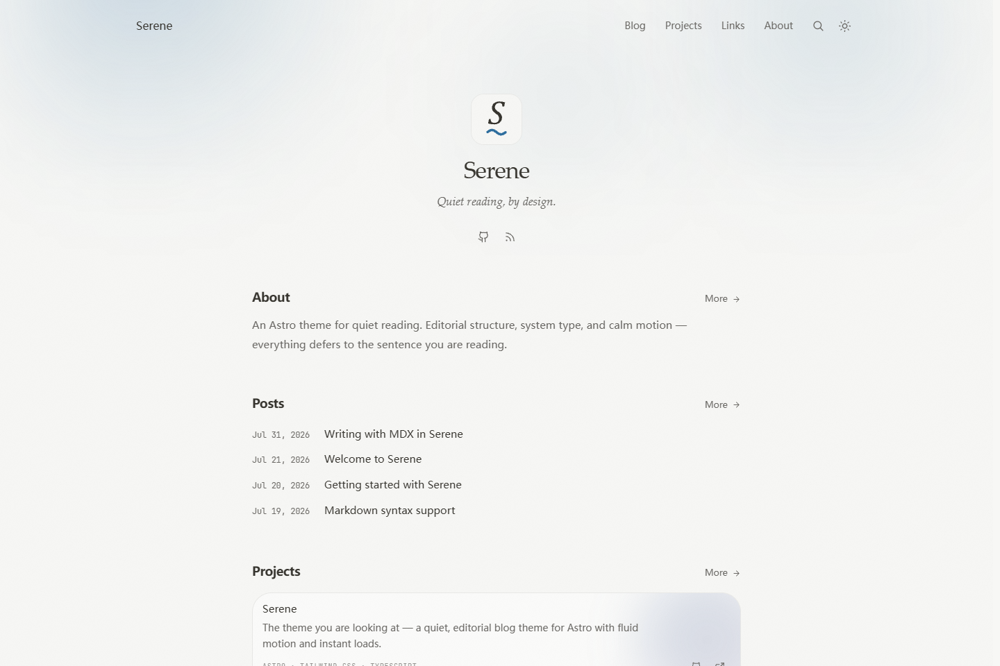
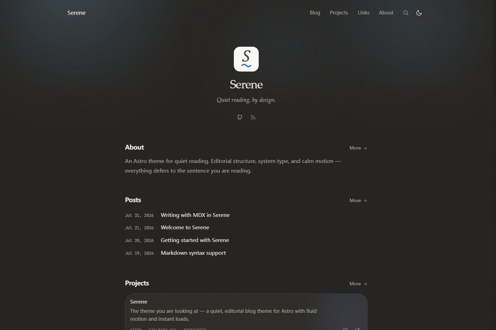

# Serene

[](https://astro.build) [](https://tailwindcss.com) [](https://github.com/yu030x/astro-theme-serene/deployments) [](LICENSE)

A quiet, editorial blog theme for **Astro**. It is static by default, uses system fonts, and keeps the reading column deliberately small.

English | [简体中文](./README.zh-CN.md) · **[Live demo →](https://astro-theme-serene.vercel.app)**



<details>
<summary>More screenshots</summary>




</details>

## Features

- Editorial blog pages with categories, tags, archive, RSS, sitemap, Open Graph and JSON-LD.
- Markdown and MDX support, including KaTeX math, sidenotes, syntax highlighting and Callouts.
- Reading-first details: table of contents, progress bar, image zoom, dark mode and reduced-motion support.
- Static search with Pagefind; Waline comments, reactions and GitHub contributions are optional.
- No required backend. Build `dist/` and deploy it to any static host.

## Deploy

[](https://vercel.com/new/clone?repository-url=https%3A%2F%2Fgithub.com%2Fyu030x%2Fastro-theme-serene)

## Quick start

Requires [Node.js](https://nodejs.org/) **22.12+** and [pnpm](https://pnpm.io/installation) **12**.

```bash
git clone https://github.com/yu030x/astro-theme-serene.git my-blog && cd my-blog && pnpm install --frozen-lockfile && pnpm run dev
```

| Command | Purpose |
|---------|---------|
| `pnpm run dev` | Development server with hot reload |
| `pnpm run check` | Astro type and template diagnostics |
| `pnpm run build:astro` | Astro static build only; does not generate a Pagefind index |
| `pnpm run build:search` | Generate the Pagefind index in the existing `dist/` |
| `pnpm run build` | Astro static build followed by Pagefind index generation |
| `pnpm run preview` | Preview the production build |
| `pnpm run test:browser` | Run Chromium search and reading-interaction regression checks |

`pnpm run dev` serves the development site without a production Pagefind index; this is expected, and search is not a production-readiness check in that mode. For a deployable production site, run `pnpm run build` (or run `pnpm run build:astro` followed by `pnpm run build:search`) so `dist/` contains the Pagefind index before `pnpm run preview` or deployment.

The home page is capped at `44rem`, article content at `40rem`, the top navigation at `68rem`, and the desktop scrolling navigation at `46rem`. Project cards support `compact` and `comfortable` density, with descriptions limited to two and three lines respectively and 44px action targets.

## Customize

Start with [`src/site.config.ts`](src/site.config.ts): site identity, author URL, navigation, social links, article license and optional integrations. Then replace the demo content in `src/content/blog/`, `src/data/projects.json`, `src/data/links.json` and `src/data/tools.json`.

`src/assets/tools/` ships a small set of icons to draw from; the `icon` field in `tools.json` takes any filename in that folder, and most of them are unused by the demo. Drop your own SVGs in alongside them.

UI copy defaults to English; set `uiLocale: 'zh-CN'` for Simplified Chinese — see [Localization](#localization).

Waline is disabled by default. Enable it only after adding your own server URL. Failed comment requests show a retry status; stalled loading stops after 15 seconds. Contribution requests time out after 10 seconds and retain stale cached data when a refresh fails.

## Localization

Three independent settings live in `src/site.config.ts`:

| Setting | Purpose | Default |
| --- | --- | --- |
| `uiLocale` | Built-in interface labels, accessible names and client status messages (`en` or `zh-CN`) | `en` |
| `locale` | Document/content language: HTML, Open Graph, JSON-LD and RSS | `en-US` |
| `dateLocale` | Displayed article dates | `en-US` |

Changing only `uiLocale` translates the built-in interface without changing dates or URLs. Set `locale` to match your content and document language separately. Article text, the About demo prose, site identity, project/link/tool data and custom labels remain authored content.

Default navigation entries use translation keys, such as `{ labelKey: 'nav.blog', href: '/blog' }`. Existing custom entries like `{ label: 'My writing', href: '/blog' }` still work; an explicit `label` takes priority over `labelKey`.

Astro components and browser scripts share `src/lib/i18n.ts`. Missing translated keys fall back to English, and parameters are rendered as text. This feature does not add multilingual content routes or translate articles.


## Series

Existing articles need no migration. To group a post, add this optional frontmatter object:

```yaml
series:
  id: writing-a-series
  title: Writing a small series
  order: 1
```

`id` is a stable lowercase slug (letters, digits and single hyphens) used in `/series/<id>`. Every part must use the same nonempty `title` and a unique positive integer `order`. Ordering follows `order`, not dates or filenames; gaps are allowed. Missing fields, invalid values, duplicate orders and conflicting titles fail validation with an error. Single-post series are supported.

The blog index shows a Series link only when a visible series exists. Series articles show their position and previous/next parts instead of chronological navigation; ordinary articles keep their existing navigation. Production excludes drafts from series routes, counts and links. Development includes drafts and validates them against published parts; the content schema validates each draft's fields in either mode.

The `series-planning.md`, `series-building.md` and `series-draft.md` examples deliberately use dates that differ from reading order. Remove or replace them with your own content. Renaming a series `id` changes its URL; keep IDs stable or configure redirects on your host. Series titles and article text are authored content, while navigation labels follow `uiLocale`.

## Project structure

```text
astro-theme-serene/
├── .github/assets/      # README preview screenshots
├── public/              # Favicon, avatars, OG image and link icons
├── src/
│   ├── assets/          # Avatars, post images and tool icons
│   ├── components/      # Reusable UI
│   ├── content/blog/    # Markdown and MDX posts
│   ├── data/            # Projects, links and tools
│   ├── layouts/         # Page shells
│   ├── lib/             # Content, date and image helpers
│   ├── pages/           # Astro routes
│   ├── plugins/         # Markdown/MDX plugins
│   ├── scripts/app.ts   # Client interactions
│   ├── styles/global.css    # Tokens and component styles
│   ├── content.config.ts    # Content schema
│   └── site.config.ts   # Site settings
├── astro.config.ts      # Astro integrations and Vite setup
├── package.json         # Scripts and dependencies
├── pnpm-lock.yaml       # Reproducible dependency graph
├── pnpm-workspace.yaml  # pnpm build-script permissions
├── tsconfig.json        # TypeScript configuration
├── CONTRIBUTING.md      # Contribution checks
└── LICENSE              # MIT license
```

## Contributing

For repeatable local resource measurements, run `pnpm run measure:performance baseline`.

Run `pnpm run check` and `pnpm run build` before opening a pull request. See [`CONTRIBUTING.md`](CONTRIBUTING.md) for the full checklist.

See [CHANGELOG.md](CHANGELOG.md) for notable changes. Preserve personal configuration/content when upgrading; local validation is not remote CI or deployment evidence.

For interaction changes, install Chromium and test the freshly built site:

```bash
pnpm exec playwright install chromium && pnpm run build && pnpm run test:browser
```

The suite starts production previews on ports 4399 (normal build), 4400 (integration/series fixtures) and 4401 (Chinese configuration); all three ports must be available. `test:browser` first builds isolated fixtures under `docs/`, including a no-series configuration, leaving the deployable `dist/` unchanged. It covers search, responsive reading, cover sizing, contributions, comments, localization, series and generated canonical/RSS/sitemap/robots/Pagefind artifacts. Third-party responses are controlled locally; no personal token or real comment submission is needed. Reports and screenshots are saved under `docs/browser-evidence/`; screen-reader and deployed-site checks require separate validation.

## Thanks

Inspired by [astro-theme-pure](https://github.com/cworld1/astro-theme-pure) and [Litos](https://github.com/Dnzzk2/Litos).

## License

[MIT](LICENSE)
