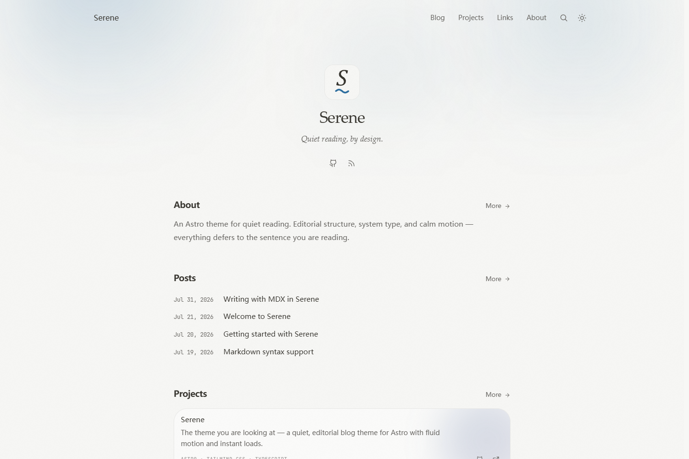
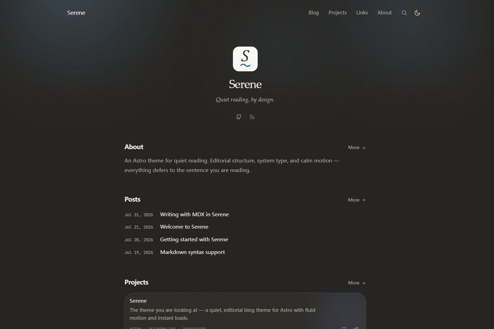

# Serene

[](https://astro.build) [](https://tailwindcss.com) [](https://github.com/yu030x/astro-theme-serene/deployments) [](LICENSE)

基于 **Astro** 的宁静编辑式博客主题：静态优先、系统字体、克制动效，以及适合长文阅读的窄阅读列。

[English](./README.md) | 简体中文 · **[在线演示 →](https://astro-theme-serene.vercel.app)**



<details>
<summary>更多截图</summary>




</details>

## 特性

- 编辑式博客页面：分类、标签、归档、RSS、站点地图、Open Graph 与 JSON-LD。
- 支持 Markdown、MDX、KaTeX 数学公式、旁注、代码高亮和 Callout。
- 以阅读为先：目录、阅读进度、图片放大、暗色模式和 reduced-motion 支持。
- Pagefind 静态搜索；Waline 评论、点赞和 GitHub 贡献图均为可选。
- 无需后端，构建后的 `dist/` 可部署到任意静态托管。

## 部署

[](https://vercel.com/new/clone?repository-url=https%3A%2F%2Fgithub.com%2Fyu030x%2Fastro-theme-serene)

## 快速开始

需要 [Node.js](https://nodejs.org/) **22.12+** 和 [pnpm](https://pnpm.io/installation) **12**。

```bash
git clone https://github.com/yu030x/astro-theme-serene.git my-blog && cd my-blog && pnpm install --frozen-lockfile && pnpm run dev
```

| 命令 | 作用 |
|------|------|
| `pnpm run dev` | 本地开发与热更新 |
| `pnpm run check` | Astro 类型与模板检查 |
| `pnpm run build:astro` | 仅执行 Astro 静态构建，不生成 Pagefind 索引 |
| `pnpm run build:search` | 为已有的 `dist/` 生成 Pagefind 索引 |
| `pnpm run build` | Astro 静态构建后生成 Pagefind 索引 |
| `pnpm run preview` | 预览生产构建 |
| `pnpm run test:browser` | 在生产构建上执行 Chromium 搜索与阅读交互回归检查 |

`pnpm run dev` 使用没有生产 Pagefind 索引的开发站点，这是预期行为，不能用开发模式判断生产搜索是否就绪。要部署生产站点，请运行 `pnpm run build`（或先运行 `pnpm run build:astro`，再运行 `pnpm run build:search`），确保 `dist/` 含有 Pagefind 索引后再运行 `pnpm run preview` 或部署。

首页最大宽度 `44rem`、文章正文 `40rem`、顶端导航 `68rem`、桌面滚动导航 `46rem`。项目卡片支持 `compact` 和 `comfortable` 密度，描述分别限制为两行和三行，操作按钮点击区域为 44px。

## 自定义

从 [`src/site.config.ts`](src/site.config.ts) 开始：修改站点信息、作者 URL、导航、社交链接、文章许可证和可选服务。然后替换 `src/content/blog/`、`src/data/projects.json`、`src/data/links.json` 与 `src/data/tools.json` 中的示例内容。

`src/assets/tools/` 内置了一组可选图标，`tools.json` 的 `icon` 字段填该目录下的任意文件名即可；其中多数示例并未用到。也可以直接放入自己的 SVG。

界面文案默认英文；设置 `uiLocale: 'zh-CN'` 即可切换简体中文，详见[多语言](#多语言)。

Waline 默认关闭。填入自己的服务地址后再启用。评论请求失败会显示重试状态，持续加载超过 15 秒后停止；贡献图请求超过 10 秒后停止，刷新失败时保留过期缓存。

## 多语言

`src/site.config.ts` 中提供三个独立设置：

| 设置 | 用途 | 默认值 |
| --- | --- | --- |
| `uiLocale` | 主题界面文案、可访问名称和客户端状态，支持 `en` / `zh-CN` | `en` |
| `locale` | 文档 / 内容语言，用于 HTML、Open Graph、JSON-LD 和 RSS | `en-US` |
| `dateLocale` | 文章日期的显示格式 | `en-US` |

只修改 `uiLocale` 即可切换主题自带界面，日期和 URL 保持不变。请另外将 `locale` 设为实际文档 / 内容语言。文章正文、About 示例正文、站点信息、项目 / 友链 / 工具数据与自定义标签仍由作者维护。

默认导航使用翻译键，例如 `{ labelKey: 'nav.blog', href: '/blog' }`。已有的 `{ label: '我的随笔', href: '/blog' }` 仍可使用；显式 `label` 优先于 `labelKey`，不会被自动翻译。

Astro 组件与浏览器脚本共用 `src/lib/i18n.ts`，缺失的翻译键回退到英文，插值参数按文本显示。此功能不增加多语言文章路由，也不自动翻译文章。


## 系列文章

已有文章无需迁移。需要加入系列时，在 frontmatter 中添加可选对象：

```yaml
series:
  id: writing-a-series
  title: Writing a small series
  order: 1
```

`id` 是用于 `/series/<id>` 的稳定标识，只能包含小写字母、数字与单个连字符。每篇使用相同的非空 `title`，以及系列内唯一的正整数 `order`。排序只取决于 `order`，不取决于日期或文件名，序号可以不连续。缺失字段、非法值、重复序号及不一致的标题会报错。支持只有一篇文章的系列。

存在可见系列时，文章索引才显示系列入口。系列文章显示当前位置与系列前后篇，替代按时间排列的前后篇；普通文章保持原有导航。生产构建将草稿排除在系列路由、计数和链接之外。开发模式包含草稿，并检查它们与已发布文章的序号 / 标题是否冲突；两种模式都会校验草稿自身的字段格式。

`series-planning.md`、`series-building.md` 和 `series-draft.md` 是日期与阅读顺序不同的最小示例，可删除或替换。修改系列 `id` 会改变 URL，请保持标识稳定，或在托管平台配置重定向。系列标题和文章内容由作者维护，导航文案跟随 `uiLocale`。

## 目录结构

```text
astro-theme-serene/
├── .github/assets/      # README 预览截图
├── public/              # Favicon、头像、OG 图和友链图标
├── src/
│   ├── assets/          # 头像、文章图和工具图标
│   ├── components/      # 可复用界面组件
│   ├── content/blog/    # Markdown 与 MDX 文章
│   ├── data/            # 项目、友链与工具数据
│   ├── layouts/         # 页面外壳
│   ├── lib/             # 内容、日期和图片工具
│   ├── pages/           # Astro 路由
│   ├── plugins/         # Markdown/MDX 插件
│   ├── scripts/app.ts   # 客户端交互
│   ├── styles/global.css    # 设计令牌与组件样式
│   ├── content.config.ts    # 内容 Schema
│   └── site.config.ts   # 站点配置
├── astro.config.ts      # Astro 集成与 Vite 配置
├── package.json         # 脚本与依赖
├── pnpm-lock.yaml       # 可复现的依赖锁定
├── pnpm-workspace.yaml  # pnpm 构建脚本权限
├── tsconfig.json        # TypeScript 配置
├── CONTRIBUTING.md      # 贡献检查说明
└── LICENSE              # MIT 许可证
```

## 参与贡献

可用 `pnpm run measure:performance baseline` 复测本地资源基线。

提交 PR 前运行 `pnpm run check` 和 `pnpm run build`。完整检查见 [`CONTRIBUTING.md`](CONTRIBUTING.md)。

变更记录见 [CHANGELOG.md](CHANGELOG.md)。升级时请保留个人配置与内容；本地验证不等于远端 CI 或部署验收。

修改交互后，安装 Chromium 并在最新生产构建上测试：

```bash
pnpm exec playwright install chromium && pnpm run build && pnpm run test:browser
```

测试会在 4399（正式构建）、4400（集成 / 系列测试页面）与 4401（中文配置）端口启动独立生产预览，三个端口都需空闲。`test:browser` 先将隔离测试页面（含无系列配置）构建到 `docs/` 下，不改变用于部署的 `dist/`。覆盖搜索、响应式阅读、封面尺寸、贡献图、评论、界面语言、系列文章，以及 canonical / RSS / sitemap / robots / Pagefind 产物。第三方响应在本地控制，无需个人 token 或真实评论提交。报告和截图保存在 `docs/browser-evidence/`；读屏软件和已部署站点需要单独验收。

## 致谢

视觉参考 [astro-theme-pure](https://github.com/cworld1/astro-theme-pure) 与 [Litos](https://github.com/Dnzzk2/Litos)。

## 许可证

[MIT](LICENSE)
